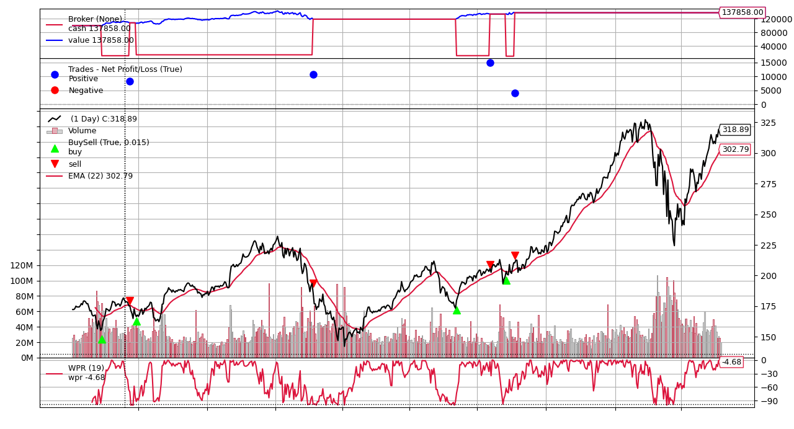
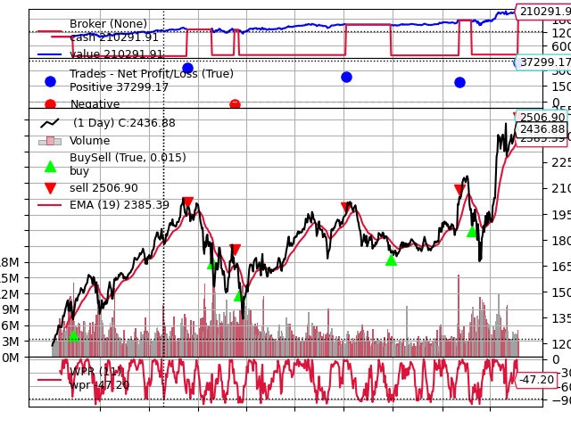
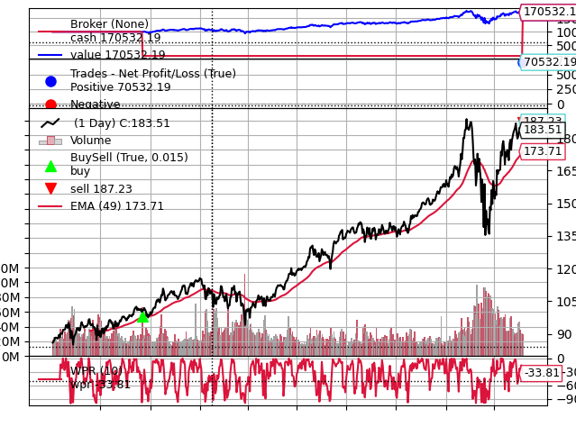

# Research in Trading Strategies

This repository explores **improvements to classic technical trading strategies** by adding **sentiment data** extracted with NLP from newspapers and daily processed news. The goal is to analyze how sentiment can enhance traditional models and optimize their performance.

- **Backtesting** with [Backtrader](https://www.backtrader.com/)
- **Hyperparameter optimization** with [Optuna](https://optuna.org/)
- **Sentiment signal**: the *Bull-Bear ratio* (`BBr`), see below

## Repository layout

```
.
├── common/            shared helpers (data location: common/data.py)
├── cci/               sentiment + CCI                 -> strategy.py, optimize.py
├── roc/               sentiment + N-day return momentum -> strategy.py, optimize.py
├── smi/               sentiment + Stochastic Momentum Index -> strategy.py, optimize.py
├── wpr_ema/           sentiment + Williams %R + EMA   -> strategy.py, optimize.py
├── wpr_rsi/           sentiment + Williams %R + RSI   -> strategy.py, optimize.py
├── only_sentiment/    strategies driven by sentiment alone (3 variants)
├── backtests/         single-run backtests with fixed parameters (one per combination)
├── data/              put the input CSVs here (not versioned)
└── docs/images/       example Backtrader plots (WPR + EMA)
```

### How the pieces relate

Each strategy folder is a small Python package with the same two files:

| File | Role |
|---|---|
| `strategy.py` | Backtrader data feed (adds the `bbr` line) and the strategy class |
| `optimize.py` | Loads the data, splits it, and runs an Optuna search that imports `strategy.py` |

`optimize.py` is the only file that imports another one (`from <package>.strategy import ...`). Everything else is stand-alone.

The scripts in `backtests/` are self-contained: feed, strategy, data loading and one backtest with parameters hard-coded in the script (their origin is not documented in the code). They do **not** import the packages above, so the strategy code is duplicated by design in this layout (see *Known limitations*).

| Strategy | Optimization (`python -m ...`) | Single run (`python -m ...`) |
|---|---|---|
| Sentiment + CCI | `cci.optimize` | `backtests.sentiment_cci` |
| Sentiment + N-day return momentum | `roc.optimize` | `backtests.sentiment_return_cumulative` |
| Sentiment + SMI | `smi.optimize` | `backtests.sentiment_smi` |
| Sentiment + WPR + EMA | `wpr_ema.optimize` | `backtests.sentiment_wpr_ema` |
| Sentiment + WPR + RSI | `wpr_rsi.optimize` | `backtests.sentiment_wpr_rsi` |
| Sentiment only | – | `only_sentiment.sentiment_only`, `only_sentiment.sentiment_only_neutral`, `only_sentiment.sentiment_only_neutral_cumulative` |

## Getting started

Requires Python 3.9+.

```sh
python -m venv .venv
.venv\Scripts\activate          # Windows;  source .venv/bin/activate on Linux/macOS
pip install -r requirements.txt
```

Run everything **from the repository root** with `python -m`, so the packages resolve:

```sh
python -m cci.optimize
python -m backtests.sentiment_wpr_ema
```

> Running `python cci/optimize.py` directly will fail with `ModuleNotFoundError: common` / `cci`.

## Data

The input CSVs are not included in the repository (`*.csv` and `data/*` are git-ignored). Each script reads one file named after a ticker, resolved by `common/data.py` in this order:

1. the folder in the `TRADING_DATA_DIR` environment variable,
2. the `data/` folder of this repository.

| Script group | Expected file |
|---|---|
| `cci`, `roc`, `smi`, `backtests/sentiment_cci`, `backtests/sentiment_smi`, `backtests/sentiment_return_cumulative`, `only_sentiment/sentiment_only_neutral*` | `AAPL.csv` |
| `wpr_ema`, `backtests/sentiment_wpr_ema` | `AMZN.csv` |
| `wpr_rsi`, `backtests/sentiment_wpr_rsi` | `GOOG.csv` |
| `only_sentiment/sentiment_only` | `DB.csv` |

Expected columns: an index/date column (the first, unnamed column is dropped and the next one is used as the date index), `Open`, `High`, `Low`, `Close`, `Adj Close`, `Volume`, plus the six sentiment scores `positivePartscr`, `certaintyPartscr`, `finhypePartscr`, `negativePartscr`, `uncertaintyPartscr`, `findownPartscr`.

### The sentiment signal

```
BULL = 0.33 * (positive + certainty + finhype)
BEAR = 0.33 * (negative + uncertainty + findown)
BBr  = 100 * BULL / (BULL + BEAR)
```

Strategies go long when `BBr` is above an upper threshold **and** the technical indicator agrees, short when it is below a lower threshold and the indicator agrees, and stay flat inside a neutral band.

## Optimization procedure

Each `<pkg>/optimize.py` uses the first 25 % of the rows for the Optuna search (`train`) and runs 500–700 trials maximizing the final portfolio value (initial cash 100 000, commission 1 %). The best parameters are printed at the end, followed by the same parameters re-run on the held-out 75 % (`test`), so both the in-sample and the out-of-sample final value are reported. The split lives in `common/data.py` (`TRAIN_FRACTION`). The `only_sentiment` scripts use their own broker settings (initial cash 100 000 / 105 000, commission 0 %–1 %).

### Evaluation window of the single-run scripts

Every script in `backtests/` and `only_sentiment/` has an `EVALUATION_WINDOW` constant at the top: `"test"` (default, out-of-sample), `"train"` or `"full"`. Their hard-coded parameters were not necessarily fitted on this split, so the held-out window is the conservative default; set `"full"` to reproduce the old behaviour.

### Rows without sentiment

When `BULL + BEAR == 0` the ratio `BBr` is undefined (0/0 = `NaN`); those rows get the neutral value `BBr = 50` in all scripts. Before, this was only attempted in the `<pkg>/optimize.py` files via `replace(0, 50)`, which missed the `NaN` rows and wrongly rewrote rows whose `BBr` was genuinely 0.

## Example output

Backtrader plots of the WPR + EMA strategy (produced with earlier versions of the scripts, before the evaluation-window and null-sentiment changes):





## Known limitations

- **No tests, and this layout has not been executed end to end** after the reorganization (the data is not in the repository); only syntax and import resolution were checked.
- **Strategy code is duplicated** between each `<pkg>/strategy.py` and the matching `backtests/` script, and the optimizers share most of their boilerplate. Extracting a common base class would be the natural next step.
- **Scripts run on import** (no `main()` / `if __name__ == "__main__"` guard), so they are meant to be launched with `python -m`, not imported.
- The `Sentiment*Strategy*_R` classes carry numeric suffixes (`...4_R`, `...7_R`) inherited from earlier iterations; they were not renamed to keep the logic untouched.
